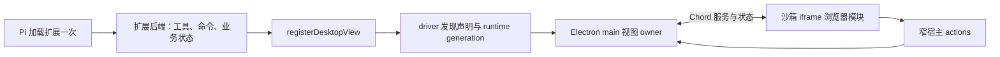

# Pi 包使用情况与 GUI 插件架构讨论

> 最后修改时间：2026-10-18 20:45 CST
> 文档版本：v4
> 修改说明：将维护中插件明确为第一方扩展，同步新目录和使用入口，标注打包内置为规划。

本文用于讨论。标为“现状”的内容来自当前代码；标为“提案”的内容尚未实现。Pi 与 Chord 已升级到 1.2，桌面视图协议同步迁移。

## 1. 盘点口径与主要判断

这里有两种“包”：Pi 自身拆分出的运行库，以及用户安装的 Pi package。后者可以包含 extensions、skills、prompt templates 和 themes；安装了 package，不等于其中每项资源都已经在 GUI 中获得对应入口。

当前项目通过 TypeScript SDK 使用 Pi，主要入口是 `@earendil-works/pi-coding-agent`，没有另写一套 agent loop。Pi 负责模型运行、工具执行和原生会话，桌面负责窗口、交互和应用能力。

GUI 插件也已有实现：普通 Pi 扩展可以注册可选桌面视图，共享同一个扩展后端。后续设计应先复用这条路径。只有超出会话生命周期的需求，才需要讨论独立的应用插件宿主。

核验基线为提交 `6bca6ec13d1b1b6ffb39c9c49cf983a6853f6309` 及当前工作区。依赖声明与 lockfile 已升级到 `1.2.0`；上游 `main` 只用于补充包目录，不用其新功能推断本项目能力。

## 2. Pi 自身有哪些包，我们用了哪些

| 包                                | 当前使用情况                                               | 在本软件中的职责或缺口                                                                                          |
| --------------------------------- | ---------------------------------------------------------- | --------------------------------------------------------------------------------------------------------------- |
| `@earendil-works/pi-coding-agent` | 桌面和 driver 的直接生产依赖                               | SDK 会话、资源加载、设置、扩展和 Pi 原生工具；是主要接入层                                                      |
| `@earendil-works/pi-agent-core`   | 经 coding-agent 间接依赖                                   | 底层 agent 执行与状态管理；本项目没有绕过 coding-agent 自建执行循环                                             |
| `@earendil-works/pi-ai`           | Pi 运行时的间接依赖；driver 另列开发依赖，部分示例直接依赖 | 模型、provider 和消息类型等基础能力；开发依赖声明不能等同于桌面直接持有独立模型运行时                           |
| `@earendil-works/pi-tui`          | 经 coding-agent 间接依赖                                   | 随 Pi 引入，但没有用它搭建桌面 UI；TUI 组件不会自动成为 React/HTML 界面                                         |
| `@earendil-works/pi-mcp`          | 间接依赖，已接入 Pi 官方 MCP add-on                        | 用 Pi 的 MCP 工厂连接服务；是否实际启用还取决于配置、扩展开关和认证                                             |
| `@earendil-works/pi-codemode`     | 间接依赖，已接入 Pi 官方 codemode add-on                   | 模型通过脚本调用工具；接入工厂不等于每次会话都启用该工具                                                        |
| `@earendil-works/pi-telemetry`    | 经 Pi 基础包间接依赖                                       | 依赖图里存在；本次没有发现本项目直接配置独立 telemetry adapter 的依据，不宣称已建立应用级遥测系统               |
| `@earendil-works/chord`           | 桌面、extension-ui 的直接生产依赖                          | 桌面扩展服务调用和状态同步；已经使用，不是待引入的替代方案                                                      |
| `@earendil-works/pi-durable`      | 当前依赖图未使用；上游 main 的包目录列出                   | 上游描述为持久化 conversation/task/document runtime；尚未评估与本项目数据所有者的重叠，不建议仅因上游提供就接入 |

另外，`tool-search` 是已接入的 Pi 官方 add-on，本次 lockfile 中没有对应的独立 `pi-tool-search` 包。它与 MCP、codemode 一起通过 coding-agent 导出的工厂注册。

旧资料中的 `@mariozechner/*` 以及 `pi-web-ui`、`pi-mom`、`pi-pods` 不在本次依赖图中。它们也不在本次获取的上游 main 包表里；这只能说明本项目未接入，不能据此判断所有历史包是否仍维护。上游当前将 Slack/chat 自动化指向独立的 `pi-chat` 项目，本软件没有接入它。

### 2.1 已使用的能力不等于完整使用了整个包

`SessionSupervisor.baseCreateOptions()` 将 Pi 官方 add-ons、应用内置扩展和隐藏生命周期扩展交给 Pi 的资源加载器。模型运行时由 Pi 按会话创建，避免不同工作区同名 provider 的 endpoint 或凭据相互污染。

当前应用内置的 Thread orchestration 和 Scheduled tasks，本身已经采用 Pi extension factory，通过窄桥接调用桌面能力。它们是“基于 Pi、但具有 pi-gui 专属能力”的现有实例。回合捕获、原生消息身份等内部 hook 也通过隐藏扩展接入。

尚未使用的包不构成待办清单。特别是 pi-durable 涉及持久化职责，采用前必须证明它解决了现有 owners 无法解决的问题，且不会产生两份会话真相。

## 3. Pi 插件怎样真正进入 GUI

### 3.1 当前能力边界

| Pi 扩展能力                                                          | 当前 GUI 接入情况                     | 对插件作者和用户的含义                                                     |
| -------------------------------------------------------------------- | ------------------------------------- | -------------------------------------------------------------------------- |
| 工具、事件 hook、provider                                            | 经 Pi SDK 执行                        | 可在 GUI 对话中生效，不要求启动 pi-cli；自定义终端渲染仍需单独处理         |
| slash command                                                        | 可由会话命令入口调用，另有兼容性记录  | 命令是否可用取决于它内部调用的 UI 能力，不能仅凭命令被发现判断             |
| `select`、`confirm`、`input`、`editor`                               | 映射为宿主 UI 请求                    | 用户在桌面交互后，结果返回原扩展调用；取消、超时和会话关闭需要保留各自语义 |
| `notify`、`setStatus`、`setTitle`                                    | 转为对应宿主请求                      | 可以进入桌面通知或会话 UI 数据流；不意味着完全复制终端布局                 |
| `setWidget` 的字符串数组                                             | 映射到输入框上下方                    | 当前只处理文本行及移除；任意组件形式不会自动显示                           |
| `setEditorText`、`pasteToEditor`、`getEditorText`                    | 适配桌面输入区文本状态                | 不等于允许插件替换整个桌面编辑器                                           |
| `ui.custom()`                                                        | 抛出带分类的 terminal-only 错误       | 插件应降级为标准对话框，或提供桌面视图                                     |
| `setFooter`、`setHeader`、`setEditorComponent`、`onTerminalInput` 等 | 当前宿主为空操作，或返回空值/无效订阅 | 插件可能加载成功但界面没有变化；这是需要显式表达的兼容性缺口               |
| working 指示器、autocomplete provider、工具展开控制等                | 当前适配中存在空操作                  | 不能承诺 Pi 终端交互完整兼容                                               |
| Pi 主题切换                                                          | 当前返回不支持；主题查询为空          | Pi 的终端主题不等于桌面主题；桌面视图从宿主接收桌面颜色                    |
| 可选桌面视图                                                         | 已实现注册、加载、服务调用和状态同步  | 作者需要提供预构建浏览器模块；普通 Pi package 不会自动生成 GUI             |

Pi 的终端渲染器、自定义工具输出和自定义消息表示，也不能笼统承诺原样复用。桌面已有 extension cards 和自定义消息相关路径；某个插件的 TUI renderer 是否获得等价展示，需要按实际使用的协议核对。

### 3.2 已有桌面视图路径

作者在普通 Pi 扩展里调用 `registerDesktopView(pi, declaration)`，声明视图 ID、标题、来源文件、frontend 资源和 backend facet 工厂。driver 使用 Pi event bus 发现声明，再与 Pi 最终加载的扩展来源匹配，不重复执行扩展 factory。

Electron main 校验声明和资源，为对应 task/view/runtime generation 管理 backend facet host。浏览器模块导出 `mount(root, host)`，通过 Chord 调用后端服务和订阅状态。宿主传入主题、连接失效信号及有限操作：打开文件、准备未发送任务草稿、打开 HTTPS 链接、打开同文件夹及其 pi-gui worktree 范围内的会话。

这条路径已经能支撑插件自定义列表、按钮和业务面板。插件业务操作走自己的 Chord service，不需要为每个插件增加应用 IPC。

### 3.3 用户如何发现与使用

当前 Extensions 页面用于查看、启停、刷新 Pi 扩展并检查诊断。扩展按 Pi 原有资源配置加载；该页面不是独立的桌面插件市场。

已注册视图从侧面板的 Add tab (+) → Extension views 打开。前端调整后可以 Reload view；后端调整使用空闲会话的 `/reload`。仓库在 extensions/ 维护 PR Review、Test Runs、GitHub、Usage、Trace 五套第一方插件。它们当前通过 Pi 配置显式加载；打包内置属于后续规划，尚未自动包含或默认启用。

`@pi-gui/extension-ui` 目前仍是私有本地 helper，尚未发布 npm。它是本项目的作者协议，不是 Pi 上游保证兼容的 API。外部作者分发前，需要解决 helper 的发布方式和构建文档，而不是另造资源扫描器。

### 3.4 生命周期与信任边界

Pi 原生 session entries 保存会话内业务结果，Chord 保存实时投影；桌面 UI 存储只保存页签引用和少量展示偏好。跨会话数据可由扩展自己的外部存储负责，不能强塞进单一会话。

关闭视图会断开订阅和连接，已经接受的后端工作可以继续；明确的请求取消才传播取消信号。Pi reload 或会话关闭使旧 generation 失效。切换任务、窗口销毁或 renderer 崩溃后，旧连接不能继续控制新任务，也不能把迟到操作转给前台窗口。

iframe 使用 opaque origin、`allow-scripts` 和受限资源协议，不能直接获得 Node 或通用 IPC。这个边界只约束浏览器前端：Pi 扩展后端仍是拥有宿主进程权限的受信任代码。Chord 的类型与消息校验不构成后端安全沙箱。

## 4. pi-gui 独有插件的架构提案

### 4.1 推荐先维护一个扩展实例与一个业务后端

建议把插件分为以下能力组合，但继续由 Pi 加载会话扩展：

| 需求                               | 建议实现                         | 与现有架构的关系                                                        |
| ---------------------------------- | -------------------------------- | ----------------------------------------------------------------------- |
| 只增加模型工具、命令和 hook        | 普通 Pi extension                | 复用现有运行时，不要求 GUI 专属依赖                                     |
| 同一业务需要桌面操作面板           | Pi extension + 可选 desktop view | 复用现有 extension-ui、Chord、视图 owner                                |
| 需要 pi-gui 的线程、调度等应用能力 | Pi extension + 明确的宿主能力桥  | 参考现有 orchestration/scheduled-tasks；新增能力必须明确 owner 和作用域 |
| 无会话也运行，或跨工作区常驻       | 单独评估应用级插件宿主           | 当前会话视图宿主不覆盖这个生命周期；属于后续提案                        |

桌面专属插件可以要求桌面宿主，缺少宿主时报告不可用。需要兼容 CLI 的插件，则应将工具和业务逻辑保留在 Pi extension 中，只有交互部分采用可选桌面视图。不要为了 CLI 兼容再启动第二个后端或复制业务状态。

### 4.2 模块归属

保留 `packages/extension-ui` 作为作者注册、浏览器协议和窄 actions 的归属。`packages/pi-sdk-driver` 只做 Pi 接入、发现和生命周期通知，不接管插件市场、窗口或前端宿主。

Electron main 的 extension owners 负责资源校验、backend host、连接和宿主操作授权；contracts 维护 browser-safe 请求与展示数据；renderer 负责布局、挂载和错误展示，preload 只暴露明确操作。插件自己的业务服务与消息校验留在插件里。

若出现必须新增的公共宿主能力，先判断它属于哪个应用 owner，再设计最窄的请求。浏览器不能自报 workspace/window 身份取得权限，也不能通过“通用 execute”入口绕过作用域校验。

### 4.3 暂不引入独立应用插件宿主

当前视图实例与 task/runtime 绑定。如果需求是“关闭全部会话后仍定时同步”“为整个应用新增导航页”或“跨工作区运行后台服务”，需要先明确应用、工作区、会话三个生命周期及停用语义，再决定宿主。

未来若实施应用级插件宿主，应由 main 独立拥有激活、停用和资源释放，向 Pi 会话按需注入窄能力。不能为让插件常驻而伪造一个永不关闭的 Pi 会话。首次实施只覆盖已确认的具体场景，不预建通用插件平台。

### 4.4 分发和协议演进

近期优先保持 Pi package 作为分发单位，同包携带 Pi 入口和预构建桌面资源，安装与发现沿用 Pi；挂载时不安装依赖、不编译作者代码。

对外发布前，再定义 helper 版本支持范围、宿主能力探测和不支持时的错误。开发阶段只维护当前协议，不添加旧 pi-gui 数据迁移层。远程市场、自动更新和不受信任后端进程隔离都不属于本次建议的首轮工作。

## 5. 建议接下来的讨论顺序

1. 确认“独有插件”的首个具体例子。它是否必须在没有会话时运行？如果不需要，现有 Pi extension + desktop view 通常足够。
2. 确认兼容目标。是保证工具与命令可用，还是要求指定的第三方 Pi 插件在 GUI 中完成完整流程？后者需要给出插件及版本，逐个核对 UI 依赖。
3. 确认展示入口。现有侧面板是否满足首个场景，还是必须增加独立页面或会话卡片？只为实际需要新增展示协议。
4. 确认分发对象。如果先服务仓库内置功能，继续使用当前私有 helper；如果要第三方作者接入，优先整理公开作者契约与发布方式。

建议首轮先整理兼容性展示：让用户知道插件哪些能力可用、哪些为空操作、哪些必须提供桌面视图。然后选择一个目标插件走完整 GUI 流程，验证是否真的需要扩展宿主协议。以上均为讨论建议，本次没有执行。

## 6. 证据索引与核验限制

| 结论                         | 当前可核对的来源                                                                                                                                                                                              |
| ---------------------------- | ------------------------------------------------------------------------------------------------------------------------------------------------------------------------------------------------------------- |
| 直接依赖、间接依赖和锁定版本 | [driver package](../../packages/pi-sdk-driver/package.json)、[desktop package](../../apps/desktop/package.json)、[helper package](../../packages/extension-ui/package.json)、[lockfile](../../pnpm-lock.yaml) |
| 会话创建与官方 add-ons       | [session-supervisor](../../packages/pi-sdk-driver/src/session-supervisor.ts)、[pi-addon-extensions](../../packages/pi-sdk-driver/src/pi-addon-extensions.ts)                                                  |
| GUI UI 映射与不支持行为      | `session-supervisor.ts` 的 host UI 实现、[unsupported-host-ui](../../packages/pi-sdk-driver/src/unsupported-host-ui.ts)                                                                                       |
| 发现与单实例后端             | [desktop-extension-bridge](../../packages/pi-sdk-driver/src/desktop-extension-bridge.ts)、[helper README](../../packages/extension-ui/README.md)                                                              |
| 视图加载、安全和生命周期     | [architecture](../architecture.md)、[view owner](../../apps/desktop/electron/extensions/extension-view-owner.ts)、[frame bootstrap](../../apps/desktop/electron/extensions/extension-frame-document.ts)       |
| 应用专属内置扩展             | [main](../../apps/desktop/electron/main.ts) 的 `driverOptions.builtinExtensions`、[builtin-extensions](../../packages/pi-sdk-driver/src/builtin-extensions.ts)                                                |
| 用户操作与第一方插件         | [第一方扩展说明](../../extensions/README.md)、[Extensions 页面](../../apps/desktop/src/features/extensions/extensions-view.tsx)                                                                               |
| 上游包目录及扩展概念         | [上游 main README](https://github.com/earendil-works/pi#packages)、[v1.0.0 README](https://github.com/earendil-works/pi/blob/v1.0.0/README.md)、当前安装包的 `docs/extensions.md`                             |

本次上游快照与文档检查记录位于 `records/20261015-113454-pi-extension-review/`；升级证据位于 `records/20261015-115500-pi-1.2-upgrade/`。旧版 [Chord 探测记录](../archive/chord-feasibility.md) 和 [Workspace 验证](../archive/workspace-redesign-verification.md) 已归档，记录的是 0.87 系列及当时的 macOS 范围，不能视为当前 1.2 的验证结果；[当前 Chord 设计](../chord-desktop-extension-design.md) 已同步 1.2。

本次完成了类型检查、Chord transport 测试、桌面 view owner 测试和五个示例 bundle 构建。PR 示例的 Windows 集成测试因环境没有 `gh` 可执行文件未完成；没有完成真实 provider 验收。

## 版本修改记录

| 版本 | 修改时间             | 修改内容                                                                 |
| ---- | -------------------- | ------------------------------------------------------------------------ |
| v1   | 2026-10-15 11:36 CST | 创建 Pi 包盘点、GUI 扩展能力边界与桌面专属插件架构讨论。                 |
| v2   | 2026-10-15 12:05 CST | 记录 Pi/Chord 1.2 升级、桌面扩展协议迁移及验证限制。                     |
| v3   | 2026-10-18 20:18 CST | 将旧版 Chord 验证引用指向归档记录，补充当前设计入口。                    |
| v4   | 2026-10-18 20:45 CST | 将维护中插件明确为第一方扩展，同步新目录和使用入口，标注打包内置为规划。 |
