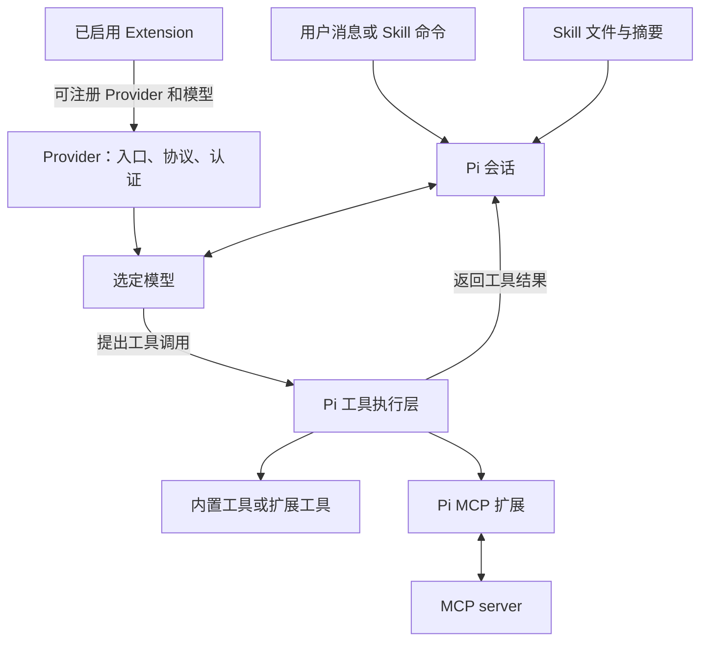

# MCP、提供商、Skill 与模型的关系及加载来源调研

> 最后修改时间：2026-10-18 21:47 CST
> 文档版本：v1
> 修改说明：梳理现有应用的资源加载、认证与使用关系，验证未配置时 Codex provider 仍出现的原因。

## 1. 结论与调研范围

**Codex 出现在提供商列表中，是因为当前 Pi 依赖内置了它，不需要用户先添加。** 当前安装的 Pi 1.2.0 将其注册为 `openai-codex`，显示名称为 `OpenAI Codex (legacy)`，支持 OAuth。这里的 `legacy` 是依赖库给出的名称。

“列表里看见”“已连接”“模型可选”“请求成功”是四个不同状态：

| 状态              | 当前实现的判定                                       | 能说明什么                                       |
| ----------------- | ---------------------------------------------------- | ------------------------------------------------ |
| 提供商出现        | 有已知模型、支持 OAuth，或有已保存凭据               | 应用知道这个提供商；不要求已经配置               |
| Connected／已连接 | `hasAuth` 为真：运行时认为已配置，或存有该提供商凭据 | 检测到了配置；不保证凭据有效、未过期或账户有权限 |
| 模型可选          | 运行时判为 `available`，且通过启用列表过滤           | 可以在模型选择器中选择；仍未证明服务可用         |
| 请求成功          | 实际发送请求并成功收到响应                           | 本次请求的认证、网络、模型权限和服务端处理成功   |

隔离验证使用空内存凭据、不存在的 `models.json`，禁止 HTTP 请求，仍得到 Codex provider 和 **9 个目录模型**；认证为 `configured: false`，可用 Codex 模型为 **0**，`fetch` 调用为 **0**。这直接验证了“没有设置也能看到 Codex”。原始结果见 [probe.log](../../records/20261018-214700-runtime-loading-research/probe.log)。

本报告基于当前工作区源码、锁文件和已安装依赖。Git 基点为 `de5b967613493b610ece8d58c5317bf33865c9c3`，工作区包含其他未提交修改，因此不能将结论直接等同于该提交或已安装发布包的行为。此次未读取用户凭据文件、未检查实际 Electron 界面的分组、未发起真实模型请求；**如果你看到的是“已连接”的 Codex，其个人凭据来源尚未确认。**

## 2. 四者分别负责什么

| 概念             | 职责                                               | 与其他概念的关系                                          |
| ---------------- | -------------------------------------------------- | --------------------------------------------------------- |
| Provider／提供商 | 定义服务入口、协议、认证方式和模型目录             | 一个 provider 可提供多个模型；同名模型可来自不同 provider |
| Model／模型      | 处理输入、生成回答并决定工具调用                   | 会话选择 `provider + modelId`；不能仅按模型名确定路由     |
| Skill／技能      | 提供任务方法、约束、说明和配套文件                 | 指令交给当前会话模型使用；自身不建立模型连接或 MCP 连接   |
| MCP server       | 按 MCP 协议提供外部工具等能力                      | Pi 的 MCP 扩展连接服务，将工具接入会话，模型再决定调用    |
| Extension／扩展  | 执行 Pi 扩展代码、注册工具、命令、hook 或 provider | 是四者间的重要接入层；MCP 本身也通过官方扩展接入          |

例如：会话选择 `openai-codex/gpt-6-sol`，用户调用一个代码审查 Skill。Skill 提供审查步骤，模型理解这些步骤；需要外部信息时，模型可以调用已接入的 MCP 工具。选择 Codex 不会自动安装这个 Skill 或 MCP 服务，配置 MCP 也不会自动提供可用的推理模型。

**Code mode（`codemode`）与 Codex provider 是不同功能。** 前者让模型通过脚本组合调用工具，后者决定模型服务路由。

## 3. 配置从哪里加载

### 3.1 两个独立的存储根目录

Pi 资源根目录由 driver 的 `createRuntimeDependencies()` 决定：

1. 调用方显式传入的 `agentDir`；
2. 未传入时使用 Pi 的 `getAgentDir()`：优先 `PI_CODING_AGENT_DIR`，否则 `~/.pi/agent`。

桌面正常组合路径没有主动设置独立的 `agentDir`，因此默认与 Pi CLI 使用相同目录。**没有在 GUI 中设置过，不代表这个目录中没有以前保存的 Pi 配置。**

Electron `userData` 则保存应用自身的 UI 状态、catalog、附件等，可由 `PI_APP_USER_DATA_DIR` 指定。它和 Pi 的资源目录独立：仅更换 `PI_APP_USER_DATA_DIR`，不会自动隔离 `~/.pi/agent` 的认证、模型、Skill 和 MCP 配置。

以下用 `<agentDir>` 表示上述解析结果，`<cwd>` 表示当前 Pi 会话的工作目录；在 worktree 会话中应核对实际 checkout，不能一律代入原仓库路径。

### 3.2 来源总表

| 资源                            | 加载来源                                                                               | 当前用途与限制                                                |
| ------------------------------- | -------------------------------------------------------------------------------------- | ------------------------------------------------------------- |
| 内置 provider 与基础模型目录    | `@earendil-works/pi-ai` 内置 provider 工厂和随包模型数据                               | 默认存在；Codex 的直接来源                                    |
| 自定义 provider、模型和覆盖配置 | `<agentDir>/models.json`                                                               | 由 Pi `ModelRuntime` 读取；GUI 自定义 endpoint 也写入这里     |
| 动态模型目录缓存                | `<agentDir>/models-store.json`                                                         | Pi 可使用缓存补充随包目录；目录内容不必完全等于发布时的数据   |
| 已保存的模型服务凭据            | `<agentDir>/auth.json`                                                                 | GUI 的登录／保存 API key 交给 Pi 运行时持久化                 |
| 环境与扩展提供的认证            | 应用进程环境、`models.json` 配置值或命令、扩展注册参数、运行时覆盖                     | 是否支持取决于 provider；不能认为任意 key 都适用于 Codex      |
| 全局资源和默认模型设置          | `<agentDir>/settings.json`                                                             | 包括 `packages`、`skills`、`extensions`、模型默认值和启用列表 |
| 项目资源与模型设置              | `<cwd>/.pi/settings.json`                                                              | 项目资源受 Pi 信任规则约束；GUI 的 per-repo 模型设置写入此处  |
| MCP 服务配置                    | `<agentDir>/mcp.json`、受信任项目的 `<cwd>/.pi/mcp.json`                               | 顶层 `mcpServers`；连接还依赖 MCP 扩展启用和服务认证          |
| 自动发现 Skill                  | `<agentDir>/skills`、`~/.agents/skills`、受信任项目的 `.pi/skills` 和 `.agents/skills` | `.agents/skills` 还有祖先目录搜索，详见下节                   |
| 显式指定及包内 Skill／扩展      | 全局或项目 `settings.json` 的资源路径和 `packages`                                     | 路径、npm 包、Git 包等由 Pi package manager 解析              |
| 应用状态                        | Electron `userData` 下的 `ui-state.json` 等                                            | 不应当作 provider 目录或 Pi 凭据的主要来源                    |

环境变量必须由 **应用进程实际继承** 才有效。在终端设置变量，并不能证明已经运行的桌面进程也拥有该变量。

## 4. Provider 与模型的加载和选择

### 4.1 加载链路

`DesktopAppStore` → `PiSdkDriver` → `RuntimeSupervisor` → Pi `DefaultResourceLoader`／`ModelRuntime` → `RuntimeSnapshot` → 设置页面和模型选择器。

工作区资源加载完成后，driver 收集已启用扩展的 `registerProvider()` 和 native provider 注册，再应用到该工作区自己的模型运行时。同一 provider 的多次注册按调用顺序合并，可改变 endpoint 等配置。因此，模型来源除了内置目录和 `models.json`，还包括 **当前工作区实际启用的扩展**。

设置快照构建显式使用 `refresh({ allowNetwork: false })`，不要求先联网查询才显示目录。Pi 模型运行时还支持远程目录及本地缓存；不能据此推断真实会话永远不会联网刷新目录。

运行会话时，`SessionSupervisor` 让 Pi 为每个会话创建自己的模型运行时，避免不同工作区扩展注册的同名 provider 混用 endpoint 或凭据。

### 4.2 为什么有目录却不能选择

`buildProviderRecords()` 汇总三类 ID：模型所属 provider、支持 OAuth 的 provider，以及有保存凭据的 provider。它没有要求 `hasAuth === true` 才进入总列表。

设置页随后分组：

- `Connected`：`hasAuth === true`。
- `Needs attention`：默认 provider 尚未连接。
- `Available`：其余未连接 provider；此处的 Available 表示可配置入口。

模型记录中的 `available` 来自 Pi 的 `getAvailable()`，与上述提供商页面分组不是同一个判断。输入框模型选择器还会检查 `enabledModelPatterns`：空列表表示允许全部可用模型；非空时按 `providerId/modelId` 精确匹配。GUI 代码在这里使用集合匹配，不能把任意通配字符串当作已正确启用模型。

模型默认值支持 app-global 和 per-repo 两种作用域。全局设置通过 Pi settings manager 保存；per-repo 写入项目 `.pi/settings.json`。会话内还可单独切换模型，已有会话恢复也涉及其原生会话记录；设置页默认值不等同于所有已打开会话的即时选择。

### 4.3 GUI 自定义 endpoint 保存什么

`CustomProviderStore` 将 GUI 管理的条目写入 `<agentDir>/models.json`，包含 `baseUrl`、`openai-completions` 协议、模型列表及 GUI 管理标记。填写的自定义 endpoint API key 也保存在该配置中；未填写时使用占位值。这与普通内置 provider 通过登录流程保存到 `auth.json` 的路径不同。

GUI 拒绝以自定义 endpoint 覆盖内置／OAuth provider ID，也不会直接接管同 ID、但不是 GUI 管理的已有配置。这不妨碍 Pi 自身按其格式读取手工维护的 `models.json`。

## 5. Codex 未手动配置的解释与定位方法

### 5.1 已证实的原因

本地依赖 `pi-ai/dist/providers/all.js` 包含 `openaiCodexProvider()`；其工厂定义：

| 字段         | 值                                    |
| ------------ | ------------------------------------- |
| ID           | `openai-codex`                        |
| 名称         | `OpenAI Codex (legacy)`               |
| 默认服务入口 | `https://chatgpt.com/backend-api`     |
| API 实现     | `openai-codex-responses`              |
| 认证         | OAuth，标为 ChatGPT Plus/Pro 订阅登录 |
| 模型         | 随包目录，并可受运行时目录／配置影响  |

因此，单凭看见 Codex，不能推断用户已经授权、应用自动登录或正在消费该 provider 的额度。当前接入通过 Pi SDK 的 provider 实现完成；本次追踪的链路没有调用 Codex CLI 来生成回复。

### 5.2 如果它显示“已连接”

先看行内状态文字，再定位来源：

| 状态文字                          | GUI 映射依据                                                    | 排查方向                                            |
| --------------------------------- | --------------------------------------------------------------- | --------------------------------------------------- |
| OAuth · connected                 | 保存的凭据类型为 OAuth                                          | 实际 `<agentDir>/auth.json` 是否已有 Pi 登录记录    |
| API key · connected               | 保存的 API key，或 Pi 报告 `stored`                             | 同上；不要仅因该行文字就推断 key 有效               |
| Environment variable · connected  | Pi 报告 `environment`                                           | 桌面进程实际继承的环境、配置引用的变量              |
| Configured externally · connected | 配置命令、`models.json` 的 key、扩展 fallback 或 runtime key 等 | 这是一组合并标签，不能直接等同于 Codex CLI 登录复用 |
| OAuth／登录按钮，位于 Available   | 尚未检测到认证                                                  | 只是内置可配置 provider，符合空凭据验证结果         |

GUI 认证来源是摘要标签，不是凭据文件的完整溯源记录。特别是 `external` 并没有表达“来自哪个外部应用”。本次检查未发现这条 Codex 接入链路主动读取 `~/.codex/auth.json` 或 `CODEX_HOME`；**不能据此宣称“自动复用了 Codex 桌面端登录”。** 精确确认个人实例，需要核对运行包版本、进程使用的配置目录及该行状态，而不是仅看名称。

建议按以下顺序定位，不必展示任何 token：

1. 确认 Codex 行所在分组和状态文字。
2. 确认运行的是哪个构建，以及其实际 `PI_CODING_AGENT_DIR`；未覆盖时为 `~/.pi/agent`。
3. 只核对凭据条目的 provider ID 和类型，并检查是否加载相关 `models.json` 配置或扩展。不要复制凭据正文到报告或聊天。
4. 若只是希望使用 Codex，通过当前应用提供的 OAuth 登录入口配置，再选择可用模型；真实发送成功才构成连接验证。

## 6. Skill 的发现与使用

### 6.1 发现入口

当前 Pi 的主资源加载链是 `DefaultPackageManager.resolve()` 先收集路径，`DefaultResourceLoader` 再加载启用的 Skill；后者调用 `loadSkills(..., includeDefaults: false)`。因此不能只读底层 `loadSkills()` 的默认目录逻辑就断言 GUI 的完整搜索范围。

实际发现来源包括：

- 用户级 `<agentDir>/skills` 和 `~/.agents/skills`。
- 受信任项目 `<cwd>/.pi/skills`。
- 从受信任项目 `<cwd>` 向祖先搜索的 `.agents/skills`：发现 Git 根时止于 Git 根，否则可搜索到文件系统根。
- 全局／项目 settings 中显式声明的 `skills` 路径。
- 已配置 Pi packages 中导出的 Skill；package manifest 可以声明资源入口。
- Pi 资源加载器支持的扩展追加路径，是否存在取决于实际启用扩展。

本仓库 `.agents/skills/verify-pi-gui` 等属于项目 Skill 的实际例子。Codex app 给本次助手提供的 `~/.codex/skills` 或插件目录，**不因此自动成为 pi-gui 的默认发现源**；需要 Pi 可识别的目录、显式路径或包配置。

同名 Skill 冲突时，底层加载器保留先加载者并记录 collision；同一真实文件经软链接重复发现会去重。应核对文件路径和加载诊断，不能只凭名称判断究竟使用哪份。

### 6.2 如何进入模型上下文

自动使用时，Pi 把启用且未禁止模型调用的 Skill 名称、描述和路径放入系统提示，指导模型在适用时读取对应文件。它不会因为目录中存在 Skill，就把所有正文无条件注入每条消息。

显式使用时，用户发送 `/skill:名称 参数`，Pi 查找已加载 Skill，读取文件、移除 frontmatter，并将正文及相对引用基准展开到消息中。`disable-model-invocation` 会隐藏自动发现提示，不等于禁止用户显式调用；斜杠命令入口还受相关设置控制。

Skills 页面展示资源的 `filePath`、`scope`、`enabled` 等信息；目录中可见不等于当前会话已加载。关闭资源、项目不受信任、解析失败或名称冲突，都可能影响实际使用。修改后还应区分资源目录刷新与当前会话 reload。

## 7. MCP 的加载、认证与生效

### 7.1 配置和连接

应用通过 Pi 官方 `createMcpExtension()` 接入，另有 `createCodemodeExtension()` 和 `createToolSearchExtension()`。这些 add-on 以 `builtin:mcp` 等资源名注册，可由 Pi 的扩展开关控制。只有配置文件存在而 MCP 扩展未启用，不足以证明工具已接入。

Pi 先读全局 `<agentDir>/mcp.json`，再读受信任项目的 `<cwd>/.pi/mcp.json`。项目同名完整配置可以替换全局定义；仅含 `enabled`、`exposure`、`toolExposure` 的项目条目也可局部覆盖全局服务器设置。不同名称若仅 `-`／`_` 不同，会产生工具命名空间冲突。

`command + args` 对应 stdio 本地进程，`url` 对应 HTTP 服务。GUI 新增服务写全局文件，启停写对应 scope 的文件，删除入口针对全局定义。全局配置改变后，应用重载相关工作区的开放会话；项目配置修改只影响对应工作区。正在执行的轮次结束后再 reload，避免中断当前任务。

### 7.2 与 Provider 认证的关系

MCP 服务通常有自己的认证，不因选择某个模型 provider 就自动获得访问权限。HTTP 服务可以配置 headers，或在需要授权时走 MCP OAuth／`/mcp` 登录流程。

但 Pi 支持一个明确例外：在**全局** MCP 配置中写 `auth: { provider: "某个 provider ID" }`，由会话模型注册表解析该 provider 的 token，供此 MCP 服务使用。项目配置禁止该字段，以限制仓库决定凭据发送目的地。因此两类认证通常独立，但存在需要显式配置的复用机制。

### 7.3 设置列表的现有限制

GUI `listMcpServers()` 是 driver 自己读取文件得到的配置摘要，隐藏 env、headers、OAuth 敏感字段并脱敏 URL；它不是服务器在线状态或工具调用成功记录。

与当前 Pi 真正连接逻辑相比，该摘要还有可观察的差异：它直接扫描项目文件，未按 Pi 的项目信任条件过滤；对没有 command／url 的项目局部覆盖条目，会报告缺少服务入口。故报告配置时应区分 **文件条目、有效合并配置、已连接工具**，不宜把设置页列表当作最终运行时状态。此处是源码核对发现，尚未通过真实 Electron 场景复现。

## 8. 证据索引与验证边界

| 结论                                        | 可核验入口                                                                                                                                                                                                                             |
| ------------------------------------------- | -------------------------------------------------------------------------------------------------------------------------------------------------------------------------------------------------------------------------------------- |
| 默认资源根目录和两个关键文件                | [runtime-deps.ts](../../packages/pi-sdk-driver/src/runtime-deps.ts)，本地 Pi `dist/config.js` 的 `getAgentDir()`                                                                                                                       |
| 桌面正常 driver 组合与 userData             | [app-store.ts](../../apps/desktop/electron/application/app-store.ts) 构造函数、[main.ts](../../apps/desktop/electron/main.ts)                                                                                                          |
| Provider／模型快照、认证摘要与扩展 provider | [runtime-supervisor.ts](../../packages/pi-sdk-driver/src/runtime-supervisor.ts) 的 `buildWorkspaceModelRuntime`、`buildProviderRecords`、`buildModelRecords`、`inferProviderAuthSource`                                                |
| Provider 分组和状态文字                     | [settings-providers-section.tsx](../../apps/desktop/src/features/settings/settings-providers-section.tsx)、[settings-utils.tsx](../../apps/desktop/src/features/settings/settings-utils.tsx)                                           |
| 模型启用过滤与全局覆盖                      | [composer-commands.ts](../../apps/desktop/src/features/conversation/composer-commands.ts)、[model-settings.ts](../../apps/desktop/src/features/settings/model-settings.ts)                                                             |
| 会话运行时隔离                              | [session-supervisor.ts](../../packages/pi-sdk-driver/src/session-supervisor.ts) 的 `baseCreateOptions()`                                                                                                                               |
| GUI 自定义 endpoint 持久化                  | [custom-provider-store.ts](../../packages/pi-sdk-driver/src/custom-provider-store.ts)                                                                                                                                                  |
| MCP 接入与 GUI 配置摘要                     | [pi-addon-extensions.ts](../../packages/pi-sdk-driver/src/pi-addon-extensions.ts)、[mcp-config.ts](../../packages/pi-sdk-driver/src/mcp-config.ts)                                                                                     |
| 当前上游 provider／Skill／MCP 行为          | 本地 `node_modules/@earendil-works/pi-ai/dist/providers/{all,openai-codex}.js`，`pi-coding-agent/dist/core/{model-runtime,package-manager,resource-loader,skills,agent-session}.js` 和 `dist/extensions/mcp/{config,runtime}.js`       |
| 实测与复现配置                              | [验证配置](../../records/20261018-214700-runtime-loading-research/config.md)、[脚本](../../records/20261018-214700-runtime-loading-research/probe.mjs)、[结果分析](../../records/20261018-214700-runtime-loading-research/analysis.md) |

本次只新增报告与调研记录，不修改产品实现。结论强度为源码追踪加空凭据模型目录验证；不包含个人账户状态确认、真实模型推理、MCP 连通性或真实 Electron 用户流程验收。Markdown 使用通用语言校订，复核术语、路径、因果关系和不确定性边界；格式检查单独记录。

## 版本修改记录

| 版本 | 修改时间             | 修改内容                                                                               |
| ---- | -------------------- | -------------------------------------------------------------------------------------- |
| v1   | 2026-10-18 21:47 CST | 创建资源关系和加载来源调研，记录 Codex 内置目录验证、认证溯源边界及 MCP 配置摘要差异。 |
